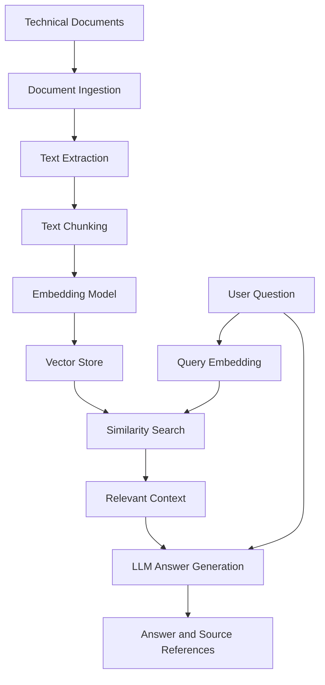

# AstraRetrieve AI
### Evidence-Grounded Research Assistant Powered by Retrieval-Augmented Generation (RAG)

AstraRetrieve AI is a Python-based research assistant designed to help users explore technical documents and research papers using semantic search and Large Language Models (LLMs). Instead of relying exclusively on a model's pre-trained knowledge, the system retrieves relevant document passages and uses them as context to generate grounded answers.

The project explores how document processing, vector search, embeddings, and language models can work together to create more useful and transparent AI applications.

**Project focus:** Retrieval-Augmented Generation (RAG) · Semantic Search · LLMs · Vector Databases · AI Engineering

---

## Table of Contents

- [Overview](#overview)
- [Problem Statement](#problem-statement)
- [Objectives](#objectives)
- [Key Features](#key-features)
- [System Architecture](#system-architecture)
- [Technology Stack](#technology-stack)
- [Project Structure](#project-structure)
- [How It Works](#how-it-works)
- [Installation and Setup](#installation-and-setup)
- [Configuration](#configuration)
- [Running the Application](#running-the-application)
- [Example Usage](#example-usage)
- [Evaluation Strategy](#evaluation-strategy)
- [Engineering Considerations](#engineering-considerations)
- [Future Improvements](#future-improvements)
- [Learning Outcomes](#learning-outcomes)
- [Contribution Guidelines](#contribution-guidelines)
- [License](#license)

## Overview

Technical knowledge is frequently distributed across research papers, technical reports, documentation, and other long-form documents. Finding the right information manually can be time-consuming, particularly when answers require connecting information across multiple passages.

AstraRetrieve AI investigates a document-grounded approach to this problem.

The system is designed around a Retrieval-Augmented Generation pipeline:

1. Ingest supported documents.
2. Extract and split their content into manageable text chunks.
3. Convert chunks into vector embeddings.
4. Retrieve semantically relevant passages for a user query.
5. Supply retrieved context to a language model.
6. Generate an answer grounded in the available evidence.
7. Present supporting source information so users can verify the answer.

The central design principle is simple: **retrieve relevant evidence before generating an answer.**

## Problem Statement

Traditional keyword search can struggle when a question uses different wording from the source document. General-purpose language models can also generate plausible answers that are not supported by a particular research paper.

AstraRetrieve AI explores how semantic retrieval and context-aware generation can help address these limitations.

The project aims to make technical-document exploration more efficient while encouraging source verification and transparent handling of insufficient evidence.

## Objectives

- Build a modular document-question-answering pipeline.
- Explore semantic search using text embeddings.
- Store and retrieve vector representations efficiently.
- Integrate retrieved context with an LLM for answer generation.
- Improve answer traceability through source references.
- Evaluate retrieval relevance and answer quality using a repeatable test set.
- Apply software engineering practices such as modular design, testing, documentation, and configuration management.

## Key Features

The following features describe the intended project capabilities. Mark a feature as complete only after implementing and testing it.

| Feature | Description |
|---|---|
| Document ingestion | Load supported technical documents and extract their text. |
| Text chunking | Divide documents into smaller passages for retrieval. |
| Semantic embeddings | Represent passages and questions as vectors. |
| Vector search | Retrieve passages that are semantically related to a query. |
| Context-grounded generation | Generate responses using retrieved passages. |
| Source references | Identify the documents or passages supporting an answer. |
| Insufficient-evidence handling | Avoid presenting unsupported answers as verified facts. |
| Evaluation | Test retrieval relevance, answer correctness, and response quality. |

## System Architecture

AstraRetrieve AI follows a modular pipeline that separates retrieval from generation.



### Core components

**1. Document processing**

Extracts text from supported files and prepares the content for indexing.

**2. Embedding generation**

Transforms text into numerical vector representations that capture semantic relationships.

**3. Vector storage and retrieval**

Stores document vectors and searches for relevant passages when a question is submitted.

**4. Answer generation**

Combines the user's question with retrieved context to produce a response.

**5. Application orchestration**

Coordinates ingestion, retrieval, generation, and output through the application's entry point.

## Technology Stack

| Technology | Purpose |
|---|---|
| Python | Core application logic |
| LangChain, if used | Orchestration of retrieval and generation components |
| Hugging Face, if used | Text embedding models |
| FAISS, if used | Efficient similarity search over vectors |
| LLM API or local model | Context-aware answer generation |
| Pytest | Unit and integration testing |
| Git and GitHub | Version control and project collaboration |

The exact dependencies should reflect the implementations in `requirements.txt`. This project does not require every listed technology; retain only the libraries actually used.

## Project Structure

```text
AstraRetrieve-AI/
├── generator.py       # Answer generation logic
├── retriever.py       # Relevant-context retrieval
├── vector_store.py    # Vector indexing and search
├── main.py            # Application entry point
├── requirements.txt   # Python dependencies
├── README.md          # Documentation
├── .gitignore         # Excluded files and secrets
└── tests/             # Automated tests (add as implemented)
```

### Module responsibilities

- `generator.py`: Handles response generation from the question and retrieved context.
- `retriever.py`: Finds relevant passages for a given query.
- `vector_store.py`: Creates, loads, or queries the vector index.
- `main.py`: Connects the components and runs the application.
- `requirements.txt`: Defines the dependencies needed to reproduce the environment.

Update these descriptions if the current implementation uses different responsibilities.

## How It Works

### Step 1: Document ingestion

The system accepts supported source documents and extracts their text. Document metadata, such as filename and page number, should be retained where possible.

### Step 2: Chunking

Long text is divided into smaller, overlapping chunks. Chunk size and overlap influence both retrieval precision and the amount of context supplied to the language model.

### Step 3: Embedding generation

Each chunk is converted into a vector using an embedding model. User questions are embedded using the compatible model so they can be compared in the same vector space.

### Step 4: Retrieval

The vector store ranks candidate chunks by similarity to the query. The most relevant passages are selected for downstream processing.

### Step 5: Context-grounded generation

The selected passages and original question are provided to the language model. The prompt should instruct the model to distinguish supported information from missing evidence.

### Step 6: Source verification

The response should identify the supporting documents or passages. Source references should be derived from document metadata rather than invented by the model.

## Installation and Setup

### Prerequisites

- Python 3.10 or a compatible version supported by your dependencies.
- Git.
- An API key if the selected language model requires one.
- Internet access for installing packages or calling a hosted model API.

### 1. Clone the repository

Replace the example username with your GitHub username.

```bash
git clone https://github.com/YOUR_USERNAME/AstraRetrieve-AI.git
cd AstraRetrieve-AI
```

### 2. Create a virtual environment

**macOS / Linux**

```bash
python3 -m venv .venv
source .venv/bin/activate
```

**Windows**

```powershell
python -m venv .venv
.venv\Scripts\activate
```

### 3. Install dependencies

```bash
python -m pip install --upgrade pip
pip install -r requirements.txt
```

### 4. Configure credentials

If the implementation uses a hosted LLM, configure the required API key using an environment variable. Never commit credentials to GitHub.

The exact variable name depends on the provider and the code in `generator.py`.

## Configuration

The following are useful configuration parameters to implement or document as the project evolves.

| Parameter | Purpose |
|---|---|
| Embedding model | Determines how document chunks and queries are represented. |
| Chunk size | Controls the approximate length of each text chunk. |
| Chunk overlap | Preserves context between adjacent chunks. |
| Top-k | Sets the number of retrieved passages. |
| Similarity threshold | Filters weakly relevant results when supported. |
| Generation model | Specifies the LLM used to produce answers. |
| Maximum output tokens | Controls response length. |

Avoid hard-coding credentials or environment-specific file paths. Keep configuration separate from application logic where practical.

## Running the Application

The repository's actual entry point is `main.py`. Once dependencies and required configuration are in place, try:

```bash
python main.py
```

This command is valid only if `main.py` is implemented as a runnable entry point. If the application uses a framework such as Streamlit, document and use its actual launch command instead.

## Example Usage

Suppose a user uploads a research paper about transformer architectures and asks:

**Question:** What is the purpose of self-attention in a transformer?

An effective RAG workflow should:

1. Embed the question.
2. Retrieve relevant passages from the uploaded paper.
3. Provide those passages to the language model.
4. Generate a concise answer based on the retrieved evidence.
5. Include references to the source document and relevant page or section, when available.

**Illustrative response format**

> Self-attention allows a model to represent relationships between tokens by computing how strongly each token should attend to other tokens in the sequence.
>
> **Source:** Uploaded research paper, relevant section or page.

This is an example of the expected response format, not a verified output from the current implementation.

## Evaluation Strategy

A useful AI project should be evaluated, not just demonstrated with a few successful questions.

Create a small test set containing questions, expected source passages, reference answers, and questions whose answers are absent from the document collection.

### Retrieval metrics

- **Precision@k:** Measures the proportion of retrieved passages that are relevant.
- **Recall@k:** Measures how many known relevant passages appear among the top-k results.
- **Mean Reciprocal Rank (MRR):** Evaluates how highly the first relevant passage is ranked.

### Generation metrics

- **Faithfulness:** Checks whether claims in an answer are supported by the retrieved context.
- **Answer correctness:** Compares answers against reference answers.
- **Citation correctness:** Verifies that cited passages actually support the corresponding claims.
- **Abstention quality:** Tests whether the system appropriately declines to answer when evidence is insufficient.

### Experimental procedure

1. Prepare a fixed set of representative questions.
2. Label the relevant passages and reference answers.
3. Run each experiment with the same test set.
4. Record retrieval and generation metrics.
5. Compare different chunk sizes, embedding models, and retrieval settings.
6. Document the results and limitations.

Do not report benchmark scores until they have been measured on a defined test set.

## Engineering Considerations

### Reliability

Handle empty documents, malformed inputs, API errors, and cases where retrieval returns no useful passages.

### Security

- Keep API keys in environment variables or an appropriate secrets manager.
- Exclude `.env`, virtual environments, and generated data from version control.
- Treat uploaded documents as untrusted input.
- Do not follow instructions found inside retrieved documents as system instructions.

### Reproducibility

Document dependency versions, model names, setup steps, and evaluation procedures so that another developer can reproduce the experiments.

### Limitations

- Retrieval quality depends on document quality, chunking, and embedding selection.
- Generated answers can still be incorrect even when relevant passages are retrieved.
- Hosted language models may introduce latency, usage limits, or API costs.
- Results depend on the chosen documents and evaluation dataset.

## Future Improvements

Potential extensions include:

- A Streamlit interface for document upload and interactive querying.
- Hybrid retrieval combining keyword search and semantic similarity.
- Reranking to improve the ordering of retrieved passages.
- Multi-document comparison and cross-document synthesis.
- More reliable page-level citations.
- Automated evaluation and regression tests.
- Retrieval latency and token-usage monitoring.
- Containerization and continuous integration.
- Experiments comparing embedding models and retrieval strategies.

These improvements should be implemented incrementally and added to the completed-feature list only when verified.

## Learning Outcomes

This project provides practical opportunities to explore:

- Retrieval-Augmented Generation architecture.
- Embeddings and semantic similarity.
- Vector indexing and information retrieval.
- LLM prompting and context management.
- Evaluation of retrieval and generated responses.
- Modular Python application design.
- Testing, version control, and reproducible experiments.
- Responsible handling of API credentials and untrusted content.

## Contribution Guidelines

Contributions and improvements are welcome.

1. Fork the repository.
2. Create a feature branch.
3. Make a focused change.
4. Add or update tests.
5. Document relevant configuration or behavior changes.
6. Open a pull request describing the change and its validation.

## License

Choose a license before distributing the project. If you select the MIT License, include the corresponding `LICENSE` file and copyright notice. If no license has been added, all rights remain reserved by default.

---

**Project:** AstraRetrieve AI  
**Domain:** AI Engineering · Information Retrieval · Natural Language Processing  
**Repository:** https://github.com/mallikarjun-git7/AstraRetrieve-AI

Built as a learning and engineering project to explore evidence-grounded AI systems and modern retrieval techniques.
